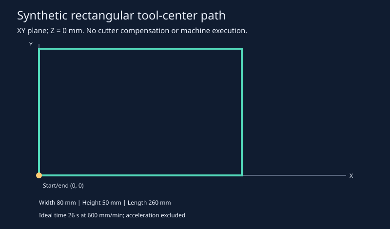
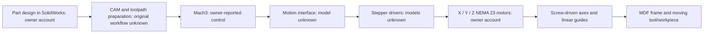

# Three-Axis CNC Milling Machine

**An educational MDF CNC machine**

The project was a three-axis CNC milling machine for education and demonstration, sponsored by the Department of Science and Technology (DST), Chandigarh. This repository reports designing the complete assembly in SolidWorks, fabricating an MDF structure joined with dowel nuts and bolts, integrating steel rails and linear bearings, and configuring Mach3 motion control with NEMA 23 stepper motors on all three axes. The reported project cost was approximately **INR 48,000**.

[Technical report](docs/report.md) · [Assembly drawings](docs/assembly-drawings.pdf) · [Certificate](docs/certificate.pdf) · [Conceptual CAD](cad/conceptual_assembly.scad) · [Saved results](results/summary.json)



## What is included

```text
cad/                    OpenSCAD assembly
config/                 Engineering demonstration parameters
docs/                   Report, drawings, BOM, certificate, and workshop images
results/                Saved JSON summary, CSV path, and SVG diagram
src/cnc_portfolio/      Standard-library-only engineering calculations
tests/                  Existing numerical and invalid-input check source
```

## Project model

The [assembly drawings](docs/assembly-drawings.pdf) and [certificate](docs/certificate.pdf) provide context for the original project. The final machine looks like [workshop view 1](docs/workshop-view-1.png) and [workshop view 2](docs/workshop-view-2.png).

## Methodology

The software computes commanded steps per millimetre from full motor steps per revolution, microstep subdivision and screw **lead** in mm/revolution. It computes ideal axial force from torque, lead and efficiency, and a simple supported-rail deflection scenario. A rectangular tool-center path illustrates coordinated movement and ideal constant-speed timing.

NEMA frame size does not specify torque, step angle, current or screw lead. The model excludes backlash, lost steps, acceleration, spindle cutting loads, controller pulse limits and joint compliance.

## Computational results

With 200 steps/revolution, 8 microsteps and 8 mm/revolution lead, the example yields **200 commanded steps/mm**, a **0.005 mm nominal command increment**, and **2,000 pulses/s at 600 mm/min**. These are command-resolution calculations.

The 80 × 50 mm rectangle has a **260 mm path length** and an ideal traversal time of **26 seconds at 600 mm/min**, excluding acceleration and other machine overhead.

### Result traceability

| Demonstration | Inputs and supporting files | Relevant source |
|---|---|---|
| Steps/mm, nominal command increment, and pulse frequency | [Parameters](config/demo.json) and [saved summary](results/summary.json) | [engineering.py](src/cnc_portfolio/engineering.py): `steps_per_mm` and `pulse_rate` |
| Ideal axial force and rail-deflection scenario | [Torque, screw and rail parameters](config/demo.json), [saved summary](results/summary.json), and [equations](docs/report.md#equations-and-units) | [engineering.py](src/cnc_portfolio/engineering.py): `ideal_axial_force` and `rail_deflection_mm` |
| Rectangular tool-center path and ideal duration | [Configuration](config/demo.json), [path coordinates](results/toolpath.csv), [path diagram](results/toolpath.svg), and [saved summary](results/summary.json) | [engineering.py](src/cnc_portfolio/engineering.py): `rectangle` and `path_length_mm`; interpretation in the [report](docs/report.md#results-and-interpretation) |

## Mechanical and control architecture


